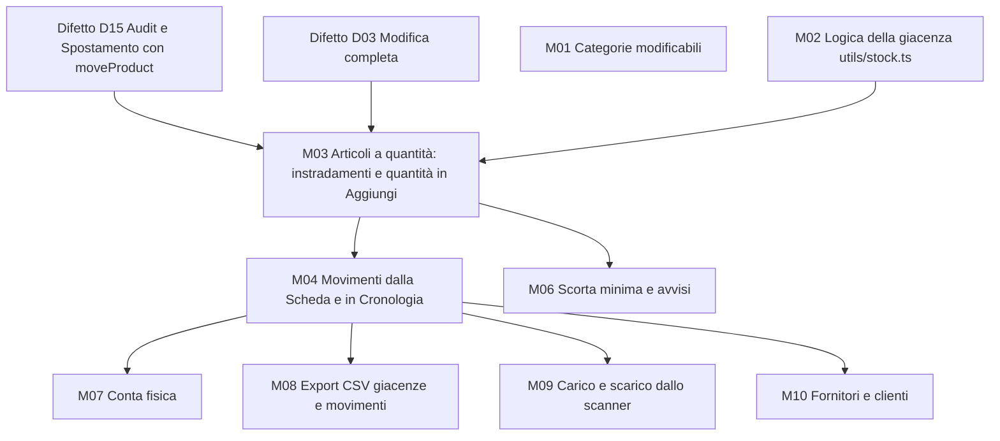

# Grafo dei lavori — gestionale di magazzino (fase B)

Esegue le decisioni di `map.md` (ticket in `issues/`). Una fetta per task, dalla più piccola; si parte solo quando le fette da cui dipende sono chiuse. Prima delle fette M vengono i difetti (`prova-funzioni.md`), in particolare D15 (Audit e Spostamento rapido con `moveProduct`) e D03 (Modifica), perché toccano gli stessi punti.

**Regola dell'utente**: «il modo più giusto e corretto e semplificato».

## Regole per ogni fetta

1. Branch `funzioni/magazzino`; un commit per fetta; `git push origin HEAD:funzioni/magazzino`; mai su `main`, niente merge né pull request.
2. Dati locali per spazio (`…:{org}`, oggi `local`); campi nuovi **facoltativi**; i dati di oggi si leggono come prima, senza riscritture forzate. Liste nuove (categorie, contatti) in contesti propri, **fuori** dall'elenco di chiavi di `InventoryContext`.
3. Logica in funzioni pure in `utils/` con test jest; le schermate chiamano quelle funzioni. I calcoli sulla giacenza si fanno dentro `setProducts(prev => …)`.
4. Ruoli del tema (`useTheme`, `makeStyles`), mai colori scritti a mano; controllo nei 5 stili con `campionario/schermate.cjs`.
5. Verde prima del commit: `npx tsc --noEmit`, `npx eslint .`, `npx jest@29.7.0 --config jest.config.js`, avvio web senza errori in console, bundle Android; prova sul web con `funzionalita/prova/lib.cjs` che legge lo stato salvato.
6. Voce in `CRONOLOGIA.md`; decisioni prese senza l'utente in `DECISIONI_DA_RIVEDERE.md`; `graphify update .`.
7. **Nessun commit in cui un prodotto può avere `stock` mentre qualche scrittura o lettura della posizione lo ignora** (M03 contiene sia gli instradamenti sia il primo modo di dare una quantità).

## Grafo

| Fetta | Ticket | Cosa | File principali | Dipende da |
| --- | --- | --- | --- | --- |
| M01 | 04 | `CategoriesContext` (chiave `furinventory_categories:{org}`, predefinita `FUR_TYPES`), Impostazioni › Categorie, etichetta «Categoria» in Aggiungi, Modifica, Scheda, PDF, campi collegati alla «Libreria Categorie» | contesto nuovo, `AddScreen`, `EditScreen`, `DetailScreen`, `SettingsScreen`, schermata nuova | — |
| M02 | 01, 02 | `stockOf`, `isAt`, `totalStock`, `mainLocation`, `isStocked`, `applyMovement` (arrotondamento a 3 decimali, «2,5», no scarico oltre la giacenza), `parseQty`; tipi `unit`, `stock`, `minStock`, evento `stock`. Test: pezzo unico letto come 1, 0.1+0.2, rifiuti, la quantità iniziale è un evento, rigiocare gli eventi ridà la giacenza salvata | `types/index.ts`, `utils/stock.ts`, `__tests__/stock.test.ts` | — |
| M03 | 01, 03 | Instradamenti: `moveProduct`, `sellProduct`, Audit, Spostamento rapido, filtri per posizione con `isAt`; Modifica con posizione e quantità in sola lettura per gli articoli a quantità. Poi la sezione Magazzino in Aggiungi (quantità facoltativa: vuota = pezzo unico; unità) che scrive `stock` e l'evento di carico iniziale; quantità ed «Esaurito» nella card e nella Scheda (per posizione) | `InventoryContext`, `AuditScreen`, `BatchMoveScreen`, `HomeScreen`, `AddScreen`, `EditScreen`, `DetailScreen` | M02, D15, D03 |
| M04 | 02 | «Movimenta» nella Scheda: carico, scarico, trasferimento, rettifica con quantità, posizioni, causale, nota; eventi `stock` in Cronologia con filtro «Movimenti»; i movimenti aggiornano `updatedAt` e `lastScannedAt` come `moveProduct` | `DetailScreen`, `TimelineScreen`, `InventoryContext` | M03 |
| M06 | 05 | `minStock` nei moduli; avviso `low_stock` per gli articoli a quantità | `InventoryContext`, `AddScreen`, `EditScreen`, `HomeScreen` | M03 |
| M07 | 06 | Schermata «Conta» da Automazioni; differenze → rettifiche in una sola chiamata | schermata nuova, `AutomationsScreen`, `linking.ts`, `InventoryContext` | M04 |
| M08 | 09 | Export CSV giacenze e movimenti | `SettingsScreen`, `utils/csv.ts`, `utils/stock.ts` | M04 |
| M09 | 08 | Azione rapida: Carico e Scarico con quantità | `ScannerActionScreen` | M04 |
| M10 | 07 | `ContactsContext`, schermata, `contactId` nei movimenti | contesto nuovo, schermata nuova, finestra dei movimenti | M04 |

Nebbia (non si esegue stanotte): lotti e scadenze, ordini e documenti di trasporto, valore di magazzino, posizioni annidate, sincronizzazione delle giacenze tra telefoni.
