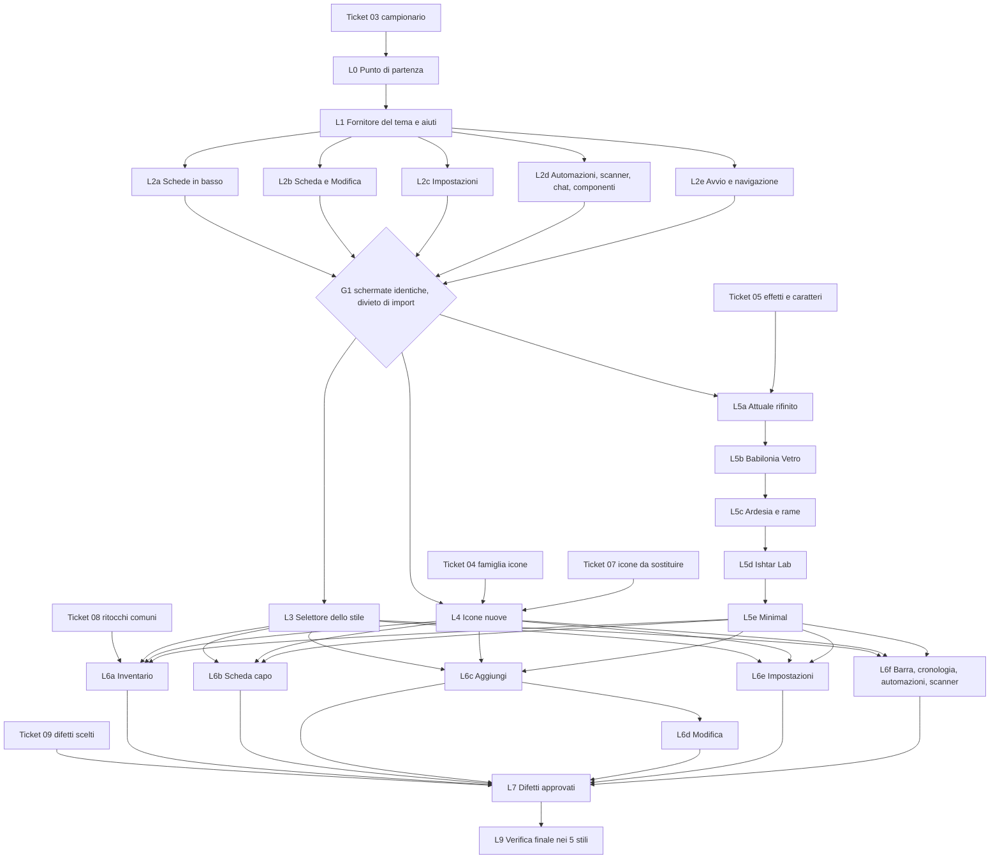

# Grafo dei lavori — i 5 stili nell'app, scelti in Impostazioni (fase 4)

Scritto il 22 novembre 2026, rivisto lo stesso giorno dopo la decisione dell'utente: **tutti e 5 gli stili nell'app, da scegliere in Impostazioni** (ticket 08). Prima la versione prevedeva un solo stile applicato ai token; ora gli stili delle schermate diventano funzioni del tema attivo.

Tutti i ticket sono risolti (22 novembre 2026): ritocchi comuni accettati (08), icone decise (07), difetti divisi (09), stampa invariata (10, quindi **L8 non si fa**). L0-L2 non cambiano l'aspetto.

**Regola dell'utente per tutti i lavori**: «il modo più giusto e corretto e semplificato». La soluzione più semplice che rispetta la tela e la struttura; niente astrazioni, opzioni o file in più del necessario.

## Regole per gli agenti esecutori

1. **Proprietà dei file**: due agenti non toccano mai lo stesso file nello stesso momento. `DetailScreen.tsx` (1878 righe), `AddScreen.tsx` (1382) ed `EditScreen.tsx` (1227) hanno un solo proprietario per volta.
2. **Branch**: il lavoro sta sul branch `ui-ux/stili` (partito da `main` con i documenti del piano), con un commit per ogni lavoro chiuso. L'utente ha autorizzato il 22 novembre 2026 il branch locale **e la pubblicazione su GitHub** (`git push origin HEAD:ui-ux/stili`); il repository `reda10nafil/inventory` è **pubblico**. Mai su `main`: nessun merge, nessuna pull request senza un nuovo sì dell'utente. Le corsie parallele lavorano in worktree separati e si uniscono in ordine.
3. **Non toccare**: `syncro_flow_flutter/`, `LOGIN_ENABLED`, la cartella `app/` (morta), il comportamento delle schermate.
4. **Verifiche di ogni lavoro**: `npx tsc --noEmit`, `npx eslint .`, `npx jest@29.7.0 --config jest.config.js`; per i lavori che cambiano file usati sul web, avvio web e confronto delle schermate; alla fine `graphify update .`.
5. **CRONOLOGIA.md** aggiornata a ogni lavoro chiuso.
6. **Fonte dei valori**: `temi/token-stili.json` (93 token per stile, estratti dalla tela https://claude.ai/artifact/GSuFD111jGM9FSNt5W5fHK). Come si applica ogni token lo mostrano le strutture comuni della tela: `project/Inventario.dc.html`, `Scheda.dc.html`, `Aggiungi.dc.html` e `Barra.dc.html` (si leggono con l'azione `read` dell'Artifact). Le tavole della tela sono il riferimento visivo; in caso di dubbio vince la tela.
7. **Il tipo del tema ha un solo proprietario** (L1). Le corsie L2 non modificano `constants/themes/types.ts`: se serve un ruolo che manca, lo segnalano al proprietario di L1, che lo aggiunge con il valore di oggi.

## Grafo

I ticket 04, 05, 07, 08 e 09 sono già risolti: nel grafo restano solo per mostrare da dove vengono le decisioni. Il ticket 10 ha tolto L8.

## Lavori

### L0 — Punto di partenza

- Blocked by: ticket 03.
- Fare: eseguire tsc, eslint, jest, bundle Android (`npx react-native bundle --platform android --dev false --entry-file index.js --bundle-output <scratch>/index.android.bundle`) e avvio web; annotare l'esito (il 21 novembre era tutto verde; `ts_errors.txt` nella radice è un file vecchio). Le schermate «prima» sono quelle del ticket 03.
- Fatto quando: esiti scritti in CRONOLOGIA; nessun lavoro successivo parte se qualcosa è rosso senza saperlo.

### L1 — Fornitore del tema e aiuti (nessun cambio visivo)

- Blocked by: L0. Proprietario unico di `constants/theme.ts`, della nuova cartella `constants/themes/`, di `contexts/ThemeContext.tsx`, `utils/color.ts`, `components/ui/AppIcon.tsx`, `components/ui/Text.tsx`.
- Fare:
  - **tipo del tema** `AppTheme` in `constants/themes/types.ts`, che rispecchia i 93 token di `temi/token-stili.json` raggruppati (colori, testo, raggi, ombre, barra in basso, campi, riquadri, pulsanti, carattere) più le **varianti di struttura**: barra `sospesa | ancorata`, voce attiva `pillola | lineetta | riquadro | solo colore`, `vetro` sì/no, sfondo `bagliori | sfumatura | pieno`, titoli di sezione `frase | maiuscolo`, `scuro` sì/no. Le sfumature CSS diventano `{ colori, angolo }` (per `expo-linear-gradient`), i bagliori radiali una lista di cerchi (per `react-native-svg`), le ombre stringhe `boxShadow`;
  - **tabella di corrispondenza dei nomi** in `constants/themes/README.md`: ogni chiave di oggi (`primary`, `surfaceElevated`, `textMuted`, …, più i nuovi token qui sotto) → il ruolo di `AppTheme` e il token della tela da cui prende il valore (`accent`, `surface`, `text-3`, `chip-active-bg`, …). Le corsie L2 usano i nomi di `AppTheme`, mai quelli della tela; L5 riempie gli stessi ruoli dai 93 token;
  - **tema «oggi»** `constants/themes/oggi.ts`: tutti i ruoli di `AppTheme` riempiti con i valori di oggi, compresi i nuovi token: `onPrimary` (`#000000`), `onAccent` (`#FFFFFF`), `scrim` / `scrimStrong`, `cameraBackground`, `qrPaper` e `qrInk` (bianco e nero fissi in tutti gli stili: i codici devono restare leggibili), `shadow`, `successSurface` / `warningSurface` e i testi sopra. Serve solo come base del controllo G1; non comparirà nel selettore;
  - **`ThemeContext`**: fornitore con lo stile attivo, letto e scritto in AsyncStorage con una chiave del dispositivo (es. `@syncro/stile`), **non** legata allo spazio `:local`, esclusa da esportazione, importazione e sincronizzazione. Il **valore predefinito del contesto è il tema «oggi»**, così jest e i componenti fuori dal fornitore funzionano senza involucro. Esporre `useTheme()` e `makeStyles(t => ({…}))`, che restituisce un hook `useStyles()` con `StyleSheet.create` memorizzato per stile;
  - **tipografia per tema**: oggi `typography` ha i colori dentro, fissati all'import; diventa `t.testo.*` calcolata per tema. Aggiungere le chiavi usate ma mancanti (`h2` 24/700 e `h3` 18/600, i valori di riserva di `AutomationsScreen`; `overline` con la resa attuale) e togliere la firma `[key: string]`. Le chiavi usate in tutto ciò che tsc compila sono: caption, cardTitle, body, sectionHeader, buttonPrimary, cardValue, buttonSecondary, h3, heroLabel, overline, h2, bodySecondary;
  - **export statico** `constants/theme.ts` lasciato con i valori di oggi, solo per `app/` e `components/DynamicFieldRenderer.tsx` (codice morto, da non toccare);
  - **differenza attesa al controllo G1**: il titolo della finestra di scelta in Aggiungi e Modifica oggi usa `typography.h3` inesistente; con `h3` definito diventa 18/600 (difetto D08, accettato);
  - `withAlpha(colore, alfa)` in `utils/color.ts` (esadecimali a 3/6/8 cifre e `rgb()`);
  - `AppIcon`: stesso uso di `MaterialIcons` (`name`, `size`, `color`, `style`), tabella di corrispondenza vuota (identità), nome sconosciuto → icona di riserva invece del `?`;
  - `Text` e `TextInput` dell'app (ticket 05, opzione b): per ora passano solo lo stile, senza carattere; il carattere arriva in L5a.
- Fatto quando: tsc/eslint/jest verdi; nessuna schermata cambia.

### L2 — Stili come funzioni del tema, colori a mano → token, `MaterialIcons` → `AppIcon` (nessun cambio visivo)

Cinque corsie parallele, ciascuna proprietaria dei suoi file. **Ogni file si tocca una volta sola**, facendo insieme:

- `const styles = StyleSheet.create({…})` a livello di modulo → `const useStyles = makeStyles(t => ({…}))` e `const styles = useStyles()` in **ogni** componente del file che usa `styles` (anche i sottocomponenti definiti fuori da quello principale). Togliere la costante `styles` del modulo fa segnalare a tsc ogni uso rimasto;
- `theme.x` e `typography.x` fuori dagli stili (`color={theme.primary}`, `placeholderTextColor`, circa 250 righe) → `const t = useTheme()`; le funzioni di modulo che restituiscono colori ricevono `t` come argomento;
- ogni colore scritto a mano → il token corrispondente (tabella in `audit-tema.md`); ogni `${colore}NN` → `withAlpha(colore, …)`;
- **raggi, ombre e bordi che cambiano tra gli stili** diventano token (raggio di card, riquadro, campo, campo piccolo, area di testo, pillola, etichetta, quadratino dell'icona, pulsante; ombra di card, pulsante, barra): Babilonia usa 18-24 e campi a pillola, Ardesia 10 senza pillole, Minimal nessuna ombra. Dei 130 `borderRadius` scritti a mano, quelli che hanno un ruolo diventano token con il valore di oggi; se oggi lo stesso ruolo ha valori diversi, si annota la differenza e la si accetta al G1 solo se è di 2 px al massimo, altrimenti si fanno due ruoli;
- ogni `<MaterialIcons` → `<AppIcon`.

**I colori che sono dati restano dati** (posizioni, palette selezionabili, automazioni, modelli, eventi, riquadri delle voci di Impostazioni). Il CSS della stampa in `DetailScreen` non si tocca qui (ticket 10).

| Corsia | File | Colori a mano |
| --- | --- | --- |
| L2a | `src/screens/tabs/*` (Home, Add, Timeline, Automations, Settings) | 80 |
| L2b | `src/screens/product/*` (Detail, Edit) | 71, di cui 34 nel CSS di stampa (non si toccano) |
| L2c | `src/screens/settings/*` (incluso il tema locale `T` di `TeamScreen`, che sparisce) | 93 |
| L2d | `src/screens/automations/*`, `ScannerScreen`, `ScannerActionScreen`, `ChatScreen`, `AuthScreen`, `NotFoundScreen`, `components/BarcodeScanner.tsx`, `components/Barcode.tsx`, `src/components/chat/*` | 112 |
| L2e | `App.tsx`, `src/navigation/*` (intestazioni native, barra in basso) | 18 |

Restano fuori: 42 colori di dati in `constants/config.ts`, `constants/sectorTemplates.ts`, `contexts/AutomationsContext.tsx`, `contexts/LocationsContext.tsx`, `hooks/useLocations.ts`, e i 7 di `components/DynamicFieldRenderer.tsx`, codice morto (80 + 71 + 93 + 112 + 18 + 42 + 7 = 423).

L2e in più: passare a `NavigationContainer` un tema di React Navigation costruito dallo stile attivo (colori e `fonts`), così intestazioni e barra seguono lo stile.

- Blocked by: L1.
- **Controllo G1** dopo tutte le corsie, con il solo tema «oggi» attivo:
  - schermate del campionario **identiche** a L0, salvo il titolo della finestra di scelta (vedi L1) e le differenze di raggio annotate;
  - nessun import di `constants/theme` nel codice vivo: aggiungere a ESLint una regola `no-restricted-imports` che lo vieta fuori da `constants/themes/`, `app/` e `components/DynamicFieldRenderer.tsx`;
  - nessuna costante `styles` di modulo che legga il tema.
  Se qualcosa cambia, si corregge prima di andare avanti.

### L3 — Selettore dello stile in Impostazioni (nuovo)

- Blocked by: G1. Proprietario: `SettingsScreen.tsx`, nuova schermata `src/screens/settings/AppearanceScreen.tsx`, la sua rotta in `src/navigation/*`.
- Fare: una riga «Aspetto» in Impostazioni, con lo stesso disegno delle righe che ci sono già (riquadro icona, titolo, descrizione con il nome dello stile attivo). Apre una schermata con i 5 stili: per ognuno nome, una striscia con fondo, superficie e accento, un campione del carattere, il segno di scelta. Toccare uno stile lo applica subito e lo salva. Non è stata disegnata nei prototipi: resta sobria, nello stile attivo. Finché i temi L5 non ci sono, la schermata elenca quelli pronti.
- Fatto quando: lo stile scelto resta dopo il riavvio dell'app (web e Android); cambiare stile non perde dati né la schermata aperta.

### L4 — Icone nuove

- Blocked by: G1, ticket 04, ticket 07. Proprietario: `components/ui/AppIcon.tsx` e la sua tabella.
- Fare: riempire la tabella `nome attuale → { famiglia, nome }` del ticket 07 (candidate nel ticket 06: barra in basso, Peso, misure, «Tutti»). Le icone sono **uguali in tutti gli stili**. I nomi salvati nei dati e nei cataloghi non cambiano. Controllare che ogni voce dei cataloghi (10, 8, 39, 106) abbia una resa.

### L5 — I 5 temi, uno alla volta

- Blocked by: G1, ticket 05. Proprietario: `constants/themes/*`, `contexts/ThemeContext.tsx`, `components/ui/Text.tsx`, `App.tsx` (solo caricamento dei caratteri e barra di stato).
- Ordine: **L5a Attuale rifinito → L5b Babilonia Vetro → L5c Ardesia e rame → L5d Ishtar Lab → L5e Minimal**. Prima gli scuri, per ultimi i due chiari: lì vengono fuori i `#000` / `#FFF` rimasti e i colori di dati che non si leggono sul chiaro.
- Ogni passo: scrivere `constants/themes/<stile>.ts` dai valori di `temi/token-stili.json`; schermate del campionario a 375 px in quello stile (`schermate.cjs` con un parametro di stile, vedi L9); contrasti (testo normale almeno 4,5:1, testo su accento come nelle schede dei token); colori delle posizioni riconoscibili. Si passa allo stile successivo solo con il passo verde.
- **Ruoli senza valore nella tela**: la tela disegna Inventario, Scheda, Aggiungi e la barra; l'app ha circa 30 schermate. Ruoli come `scrim`, superfici di successo e avviso, superficie rialzata, fondo della fotocamera e finestre dal basso non hanno un valore in tutti gli stili: il proprietario di L5 li ricava dai token dello stile (es. superficie rialzata = superficie un gradino più chiara o più scura) e li elenca nel file del tema con la regola usata.
- Il controllo di ogni passo usa **tutte le 9 schermate del campionario** (Inventario, Scheda, Aggiungi, Cronologia, Modifica, Impostazioni, Campi, Layout builder, Automazioni), non solo le 3 disegnate: è nelle altre che i valori ricavati si vedono storti.
- L5a in più:
  - **caratteri**: Inter (Attuale, Minimal), Outfit (Babilonia), Urbanist (Ishtar), Manrope (Ardesia). In `node_modules/@expo-google-fonts` oggi c'è solo `inter` (controllato il 22 novembre); per gli altri tre la scelta predefinita è installare `@expo-google-fonts/outfit`, `/urbanist` e `/manrope` (pacchetti ufficiali Expo, caratteri con licenza OFL), con `npm install --legacy-peer-deps`. Android: TTF in `android/app/src/main/assets/fonts/` (ticket 05), tutte le famiglie; peso da misurare, fino a circa 4 volte gli 1,7 MB di Inter. Web: `useFonts` solo per la famiglia dello stile attivo, con attesa finché non è pronta. Il `Text` dell'app sceglie il file in base alla famiglia attiva e al peso, con una **mappa dei pesi per stile** (i pesi del codice 400-800 diventano quelli dello stile, es. Babilonia non va oltre 600);
  - **stili chiari**: barra di stato chiara o scura secondo `scuro` (`expo-status-bar` è già nelle dipendenze), tema di React Navigation, sfondo della pagina web, colore della barra di navigazione Android (`expo-navigation-bar` è già nelle dipendenze; controllare se l'app lo usa); il colore della schermata di avvio in `app.json` è unico e resta quello di oggi;
  - da L5a lo **stile predefinito** per chi non ha scelto è Attuale rifinito.
- Vetro (Babilonia e Ishtar): ogni stile con vetro ha anche il velo senza sfocatura nei token (`bar-bg`), usato dove la sfocatura è spenta; nulla è stato provato su un telefono (ticket 05).

### L6 — Ritocchi per schermata, una volta per tutti gli stili

Seguono le tavole della tela. Si fanno **una volta**, guidati dai token e dalle varianti: niente `if (stile === …)` nelle schermate, solo letture di `t`. Struttura e funzioni restano uguali. Blocked by: L3, L4, L5e e la risposta dell'utente sui ritocchi comuni (ticket 08). Ogni corsia controlla le sue schermate nei 5 stili.

| Corsia | File | Punti da controllare |
| --- | --- | --- |
| L6a | `HomeScreen.tsx` | card a 2 colonne con foto in alto (con o senza margine intorno alla foto, `photo-inset`); etichette Venduto/Attenzione sulla foto; pillole cartelle e filtri; 3 statistiche in una riga; selezione multipla |
| L6b | `DetailScreen.tsx` (non il CSS di stampa) | riquadri mezzi e interi di ogni tipo; posizione col suo colore; barra fissa Indietro/Modifica (vetro dove previsto) |
| L6c | `AddScreen.tsx`, nuovo `components/ui/formStyles.ts` | ogni controllo a 1/3 (circa 106 px), 1/2, intera; campi a pillola o rettangolari secondo lo stile; riquadri di scelta; contatore; documento; sezione (maiuscolo o no); finestra dal basso |
| L6d | `EditScreen.tsx` | riusa `formStyles.ts` di L6c perché Modifica e Aggiungi restino uguali (Blocked by: L6c) |
| L6e | `src/screens/settings/*` | righe con riquadro icona; Campi e costruttore; Layout builder (barretta della larghezza, scelta icone); Posizioni, Cartelle, GS1, Hardware, Cestino, Condivisione, Team, Aspetto |
| L6f | `src/navigation/*`, `TimelineScreen`, `AutomationsScreen`, `src/screens/automations/*`, Scanner, Azione rapida, Chat, `components/BarcodeScanner.tsx` | **barra in basso ridisegnata** con le varianti (sospesa con vetro o ancorata; voce attiva in pillola, con lineetta, su riquadro o solo colore), stesse 5 voci; sfondo con bagliori o sfumatura dove previsto; intestazioni native; pulsanti di scansione; finestre dal basso; riquadri di esito |

### L7 — Difetti approvati

- Blocked by: ticket 09 e la corsia L6 che possiede il file del difetto. Ogni difetto scelto lo corregge chi possiede quel file, dopo i ritocchi.
- Difetti (ticket 09): D04 e D17 in `DetailScreen.tsx`; D06 in `HomeScreen.tsx`; D07 nelle schermate dell'app (non nel PDF); D11 nei messaggi e nei file con byte non UTF-8; D22, D23 (solo se esiste già un generatore di SKU) e D24 in `AddScreen.tsx`. D01, D05, D09 e D10 sono già nei ritocchi L6, D08 in L1. Ogni correzione di comportamento (D22-D24) con un test jest dove il codice lo permette.

### L8 — Stampa (non si fa)

- Ticket 10: PDF ed etichetta restano come oggi, indipendenti dallo stile. Il CSS della stampa in `DetailScreen.tsx` non si tocca in nessun lavoro.

### L9 — Verifica finale nei 5 stili

- Blocked by: tutti.
- Fare: tsc, eslint, jest, bundle Android, avvio web senza errori in console; `schermate.cjs` con un parametro di stile (scrive la chiave dello stile in AsyncStorage prima di caricare) e schermate «dopo» del campionario a 375 px **in ognuno dei 5 stili**, accanto a quelle «prima»; prova di ogni tipo di campo a 1/3, 1/2 e intera; un campo per ogni icona dei cataloghi; colori delle posizioni; cambio di stile dal selettore e riavvio; `graphify update .`; voce in CRONOLOGIA; resoconto breve all'utente. Prova su telefono Android (vetro, caratteri, ombre): da chiedere all'utente, non verificabile da qui.
